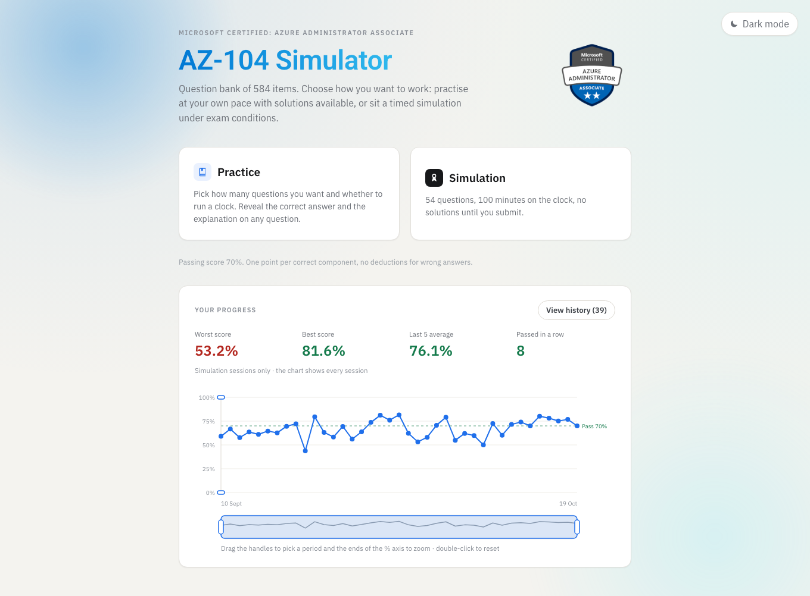
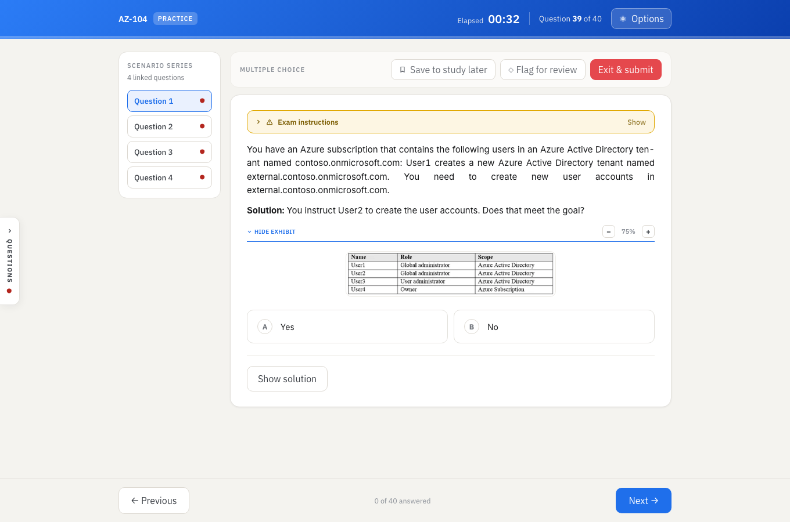
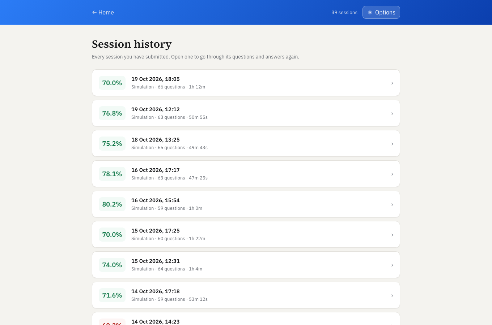
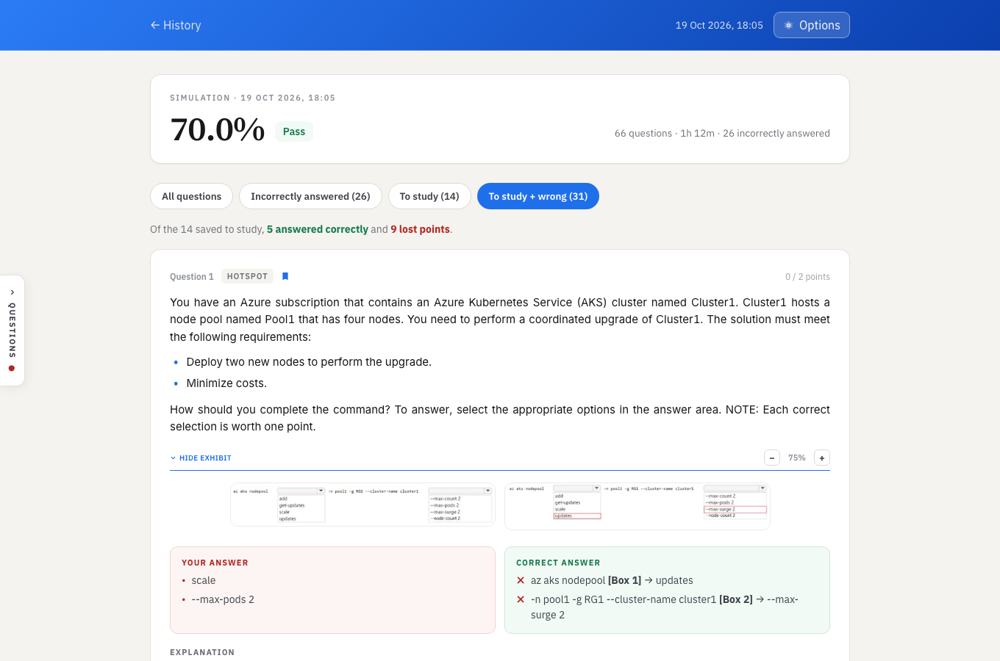

# AZ-104 Simulator

An exam simulator for the Microsoft AZ-104 (Azure Administrator Associate) certification, built around a question
bank of 584 items. .NET 10 Web API, PostgreSQL, React + TypeScript — the whole stack runs in Docker, so nothing has
to be installed locally except Docker itself.

## Screenshots

Home screen: pick a mode and see where your Simulations stand — worst and best score, the average of the last five
and how many you have passed in a row. The chart of every session can be zoomed on a period and on the score axis.



A question during a practice session, with its attached screenshot (*exhibit*) open and the solution available on
demand. This one belongs to a scenario series, so its linked questions are listed alongside. *Save to study later*
marks it for after the session; *Flag for review* is for coming back to it before submitting.



History of submitted sessions: open any past attempt to go through its questions, your answers and the solutions.



Inside a past attempt: every question with your answer, the solution and its explanation, filtered here to the
questions you saved to study later together with the ones you got wrong.



## What it does

- **Two modes.** *Practice* lets you choose how many questions you want — or go open-ended and stop whenever you
  like, scoring only what you answered — whether to run a clock, and whether the solution should appear on its own
  as soon as you answer. *Simulation* is a fixed timed set under exam conditions.
- **Microsoft's own partial credit rule**: one point per correctly answered component, nothing deducted for wrong
  ones, so a single mistake never zeroes out a multi-part question. Drag-and-drop sequences are scored by position,
  while the few that ask *which* objects to pick are scored as a set, in any order.
- **Moving around a session**: Previous/Next or the ← → keys, a question panel that can show only the unanswered or
  the flagged questions, and *Flag for review* for the ones to check again before submitting.
- **Exhibits**: the screenshots that come with a question are shown inline and can be zoomed in and out, since many
  of them are small and dense.
- **History and progress**: every submitted session is kept with its questions and answers. The home screen charts
  them all — zoomable on a period and on the score range — and sums up your Simulations: worst, best, average of the
  last five and passes in a row.
- **Study later**: mark any question during a session with *Save to study later*, then find it in the review at the
  end of the session and in the history, where it can also be listed together with the questions you got wrong.
- **Sessions survive an interruption.** The session in progress is saved as you go, so a reload, a closed tab or a
  laptop lid coming down doesn't cost you your answers — and the clock stops while the app is away.

## Project layout

```
AZ-104.Simulator.sln               .NET solution (API + tests)
src/
  AZ-104.Simulator.Api/            .NET Web API
  AZ-104.Simulator.Web/            React + TypeScript frontend
  AZ-104.Simulator.Importer/       question bank importer (Python)
tests/
  AZ-104.Simulator.Api.Tests/      API unit tests
db/                                SQL schema
dataset/                           source data (JSON, a human-readable Markdown version, the exhibit images)
docs/screenshots/                  the images in this README
docker-compose.yml
```

Each folder under `src/` is one Docker service: `api`, `web` and `importer`.

## Getting started

### First run

```bash
docker compose --profile setup run --rm importer
docker compose up -d
```

The first command creates everything it needs on its own — volume, database, schema — waits until it is ready and
imports the 584 questions: nothing else has to be started by hand beforehand. The second one brings up the API and
the frontend, which by then find a populated database.

The API is served at **http://localhost:5080**, with interactive documentation at **http://localhost:5080/swagger**.
The frontend is at **http://localhost:5173**.

### Subsequent runs

```bash
docker compose up -d
```

The database and the questions live in a Docker volume, so this command is all it takes — no need to run the
importer again. That is only necessary after a `docker compose down -v` (which wipes the volume), or when you want
to reload the question bank from an updated JSON file.

### Reloading the question bank

The importer replaces the contents of the question tables with what it reads from
`dataset/az104_606_domande.json` — it is not incremental. Note that the JSON is **copied into
the importer image** at build time rather than mounted, so after editing the dataset rerun it with `--build`,
otherwise the stale copy gets imported again:

```bash
docker compose --profile setup run --rm --build importer
```

### Optional services

```bash
docker compose --profile dev up -d pgweb
```

A browser-based SQL client at http://localhost:8081, handy for inspecting the database without installing anything.

### Starting over (when something gets stuck)

When things jam — an image that won't update, a frontend still serving old code, a corrupted `node_modules` in the
volume — the quickest way out is to tear everything down and rebuild:

```bash
docker compose --profile dev --profile setup down -v --rmi local --remove-orphans
```

That removes containers, volumes (`pgdata` and `web_node_modules`) and locally built images (`api`, `web`,
`importer`) in one go. **Mind what `-v` takes with it**: besides the question bank, `pgdata` holds the history of
your submitted sessions and the session in progress — the importer brings the questions back, not those. Both
profiles have to be named, or `importer` and `pgweb` are left out of the cleanup. Images pulled from external
registries (`postgres`, `pgweb`, the .NET and Node base images) are left alone; to drop those as well use
`--rmi all`, at the cost of downloading them again on the next start.

If a `docker rmi` refuses with something like `image is being used by stopped container`, a stopped container is
still holding it — often one started by hand with `docker run`, and therefore invisible to `docker compose down`,
which only manages its own services:

```bash
docker ps -a                  # lists stopped containers too, with the image each one occupies
docker rm <container>         # remove the container holding it
docker rmi <image>            # now the image can go
```

Coming back from a cleanup takes both steps of the first run, not just `up`: the images have to be rebuilt and the
question bank re-imported, since `-v` wiped the database volume.

```bash
docker compose build --no-cache                    # optional: force a rebuild with no cache
docker compose --profile setup run --rm importer   # recreate the schema and reload the 584 questions
docker compose up -d
```

## Tests

```bash
dotnet test AZ-104.Simulator.sln
```

Two test projects:

- `tests/AZ-104.Simulator.Api.Tests` — unit tests: the repositories are substituted, no database needed.
- `tests/AZ-104.Simulator.Api.IntegrationTests` — the API is started in memory (`WebApplicationFactory`) and called
  over HTTP, route by route, against a real Postgres seeded with a small question bank (`Data/seed.sql`). Responses
  are compared with approved [Verify](https://github.com/VerifyTests/Verify) snapshots, the `*.verified.txt` files
  next to the tests: when a response changes on purpose, review the `*.received.txt` Verify writes and rename it
  to `.verified.txt`.

The integration tests empty the database before every test, so they only run against a database named
`simulator_tests` — the one the [build pipeline](#build-pipeline) starts — and are skipped against anything else,
the development database included. The simplest way to run everything is therefore:

```bash
make setup build test teardown
```

For the frontend, once `web` is up:

```bash
docker compose exec web npx tsc -b --noEmit   # type check only
docker compose exec web npm run lint
```

## Build pipeline

Build and tests run in a container with the .NET 10 SDK and Node, created at the start and removed at the end.
GitHub Actions runs the same Makefile targets.

| File | What it does |
|---|---|
| `pipeline.dockerfile` | build image: .NET 10 SDK on Alpine, plus Node and npm |
| `docker-compose.pipeline.yml` | starts the build container `az-104-simulator-pipeline`, with the repo mounted on `/work`, and a throwaway Postgres (`simulator_tests`, no published port) for the integration tests |
| `Makefile` | pipeline targets, each one runs commands in the container: `build` compiles the backend and builds the frontend, `test` runs the .NET unit and integration tests and the frontend lint |
| `.github/workflows/ci.yml` | GitHub Actions pipeline, on every push and pull request: `setup` → `build` → `test` (no `teardown`: the GitHub machine is destroyed at the end of the run) |

To run the whole pipeline locally:

```bash
make setup build test teardown
```

## Handy commands

```bash
docker compose --profile dev up -d    # start every service, pgweb included (without --profile it stays down)
docker compose down -v                # wipe everything, database volume (and session history) included
docker compose stop pgweb             # stop a service behind a profile (it has to be named explicitly)
docker compose --profile dev down     # full cleanup, services behind profiles included
```
